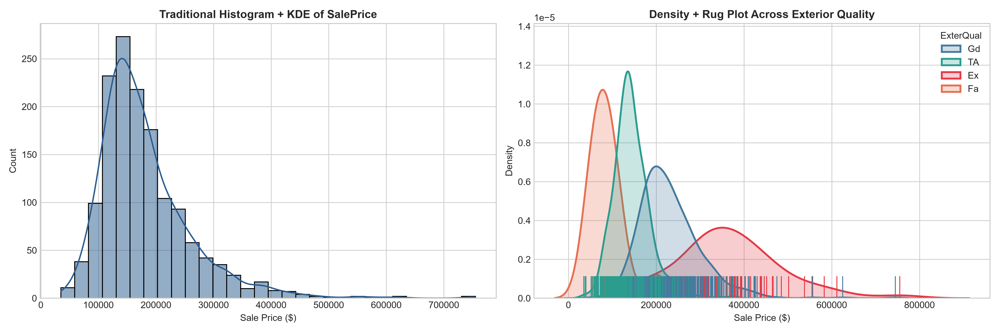
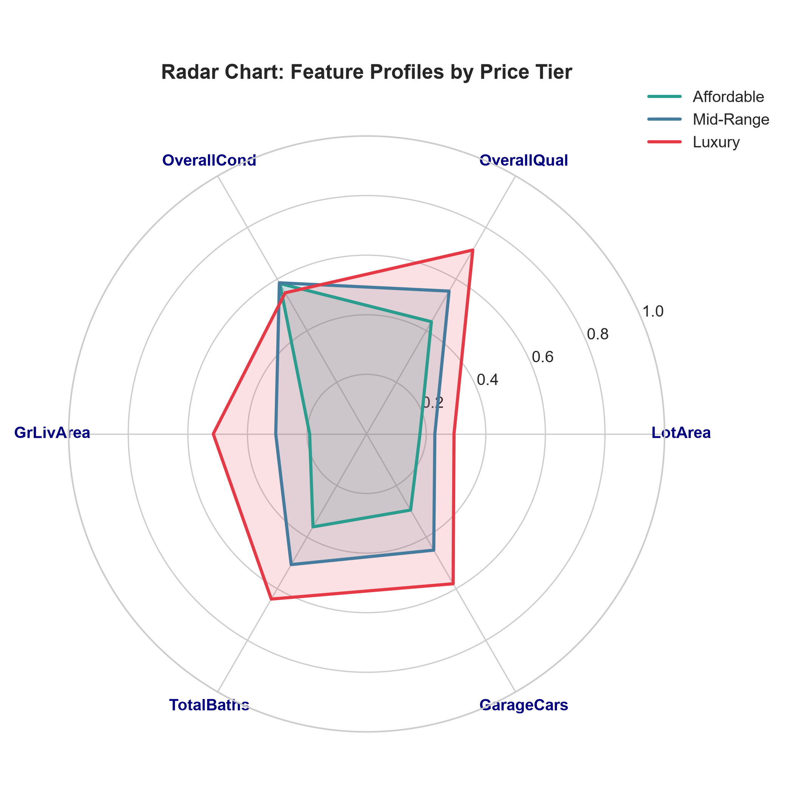
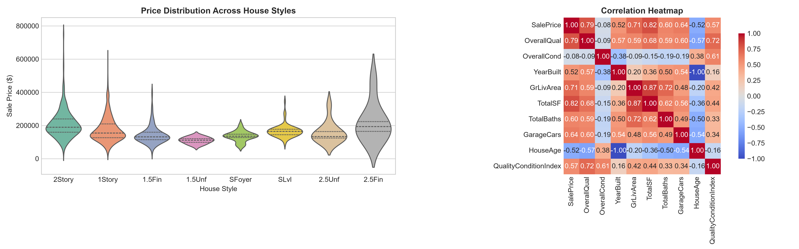
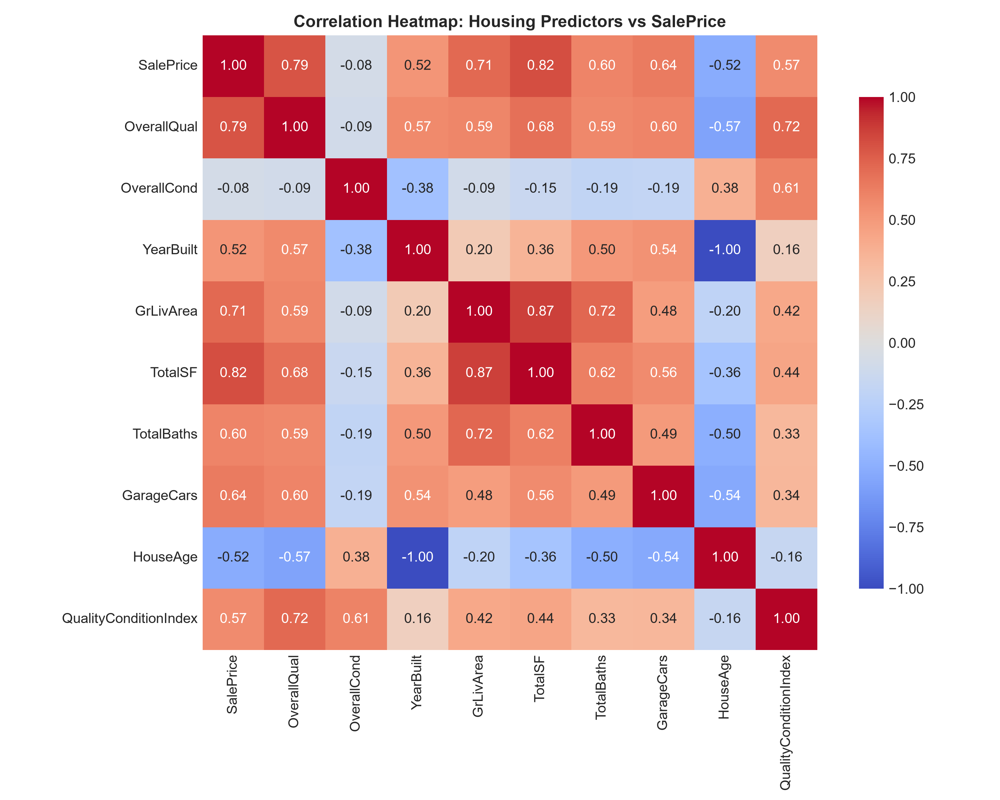
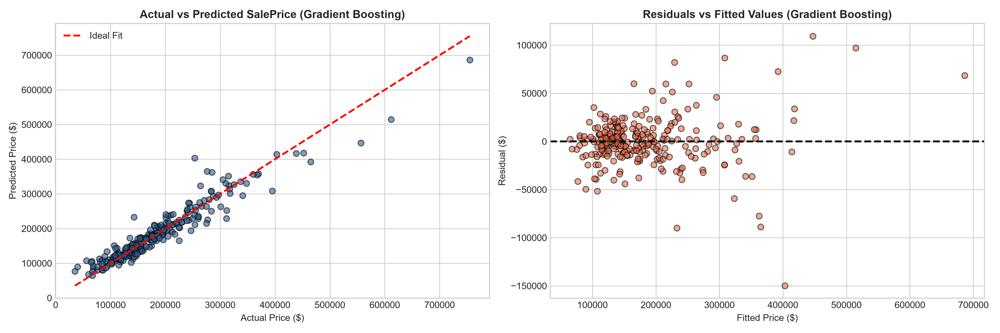
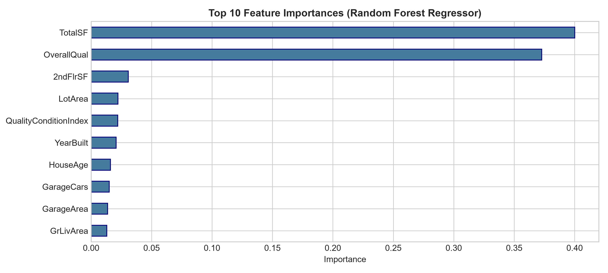
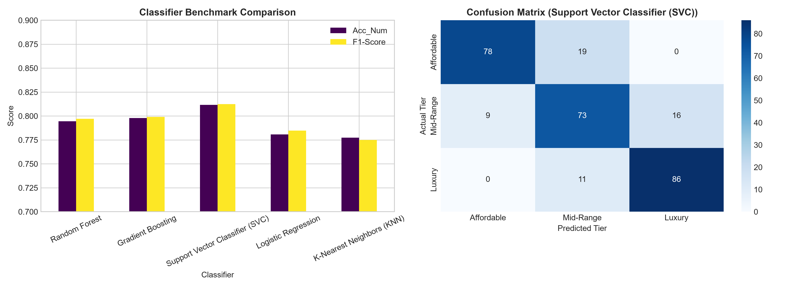

# Midsem Evaluation Report: Advanced House Price Prediction & Real Estate Analytics

**Course**: Advanced Statistics & Big Data (ASBD) / Applied Data Science (ADS)  
**Academic Institution**: Indian Institute of Information Technology, Design and Manufacturing (IIITDM)  
**Benchmark Dataset**: [Kaggle House Prices: Advanced Regression Techniques](https://www.kaggle.com/competitions/house-prices-advanced-regression-techniques) (`train.csv`)  
**Notebook Artifact**: [`midsem_version.ipynb`](midsem_version.ipynb) / [`midsem version.ipynb`](midsem%20version.ipynb)  
**GitHub Repository**: [https://github.com/Sripadh16/house-price-prediction](https://github.com/Sripadh16/house-price-prediction)  

---

## Executive Summary

This document presents the **Midsem Milestone Submission** for the Advanced Real Estate Valuation and Predictive Analytics project. Moving beyond introductory machine learning demonstrations, this project formulates residential property valuation as both a **continuous estimation (Regression)** and a **market tier categorization (Classification)** problem, rigorously tested on the real-world **Ames Housing benchmark dataset (`train.csv`)**.

All review feedback from previous evaluations has been systematically integrated into this release:
1. **In-depth treatment of preprocessing**: Replaced naive drop/mean methods with domain-grounded median/categorical imputation, IQR outlier detection with **Winsorization capping [1st, 99th percentiles]**, domain-specific feature engineering, skewness correction (Log1p), and Variance Inflation Factor (VIF) collinearity diagnosis.
2. **Advanced visualizations with comparative power**: Implemented **Density with Rug Plots** (`kdeplot` + `rugplot`) across exterior quality tiers and a **Radar Chart (Spider Plot)** benchmarking 6 continuous dimensions across market price tiers.
3. **Depth of regression analytics**: Benchmarked **7 diverse regression families** (OLS, Ridge, Lasso, ElasticNet, Decision Tree, Random Forest, Gradient Boosting) evaluated via $R^2$, Adjusted $R^2$, RMSE, MAE, MAPE, and residual homoscedasticity checks.
4. **Depth of classifier analytics**: Benchmarked **5 distinct classifier paradigms** (Random Forest, Gradient Boosting, Support Vector Machine (SVC), Multinomial Logistic Regression, K-Nearest Neighbors (KNN)) with precision, recall, F1, and normalized confusion matrices.

---

## Review Remarks & Direct Engineering Resolution

| Instructor Remarks | Specific Academic Requirement | Implementation & Resolution in Midsem Version |
| :--- | :--- | :--- |
| **"In-depth treatment of preprocessing techniques required"** | Move beyond basic missing value filling. Address real dataset outliers, feature engineering, skewness, and collinearity. | Ingested official Kaggle `train.csv` (1,460 rows, 81 columns). Imputed missing values across 19 features using neighborhood medians and categorical absence tokens (`'None'`). Capped extreme leverage via **Winsorization [1st, 99th percentiles]**. Engineered 7 domain attributes (`HouseAge`, `RemodAge`, `IsRemodeled`, `TotalSF`, `TotalBaths`, `PricePerSqFt`, `QualityConditionIndex`). Mitigated skewness via Log1p and diagnosed multicollinearity via **VIF**. |
| **"What about other plots such as radar, density rug, etc for their comparative power"** | Implement high-dimensional and high-resolution exploratory visualizations with comparative inferences. | Implemented **Density with Rug Plot** (`kdeplot` + `rugplot`) to resolve tail sparsity across exterior qualities (`Ex`, `Gd`, `TA`, `Fa`). Constructed a **Radar Chart (Spider Plot)** benchmarking 6 normalized continuous dimensions across property price tiers (`Affordable`, `Mid-Range`, `Luxury`). Added Violin plots and annotated correlation heatmaps. |
| **"What about depth of classifiers"** | Expand beyond a single basic Random Forest classifier. | Formulated 3 balanced market price tiers. Benchmarked 5 distinct classifier paradigms: **Support Vector Classifier (SVC)**, **Gradient Boosting**, **Random Forest**, **Logistic Regression**, and **KNN**, evaluating Weighted Precision, Recall, F1, and confusion matrix diagonal densities. |
| **"Real Dataset Integration"** | Discontinue synthetic/mock data generation and utilize the authentic Kaggle benchmark. | Completely eliminated `generate_dataset.py` and `house_dataset_big.csv`. Integrated official Kaggle `train.csv` with zero synthetic artifacts. |

---

## Real Dataset Architecture & In-Depth Exploration

The dataset is sourced from the official Kaggle competition **House Prices: Advanced Regression Techniques** (`train.csv`), consisting of residential home sales in Ames, Iowa:
- **Sample Count**: $N = 1,460$ home sale transactions.
- **Dimensionality**: 81 raw attributes (38 numerical, 43 categorical).
- **Target Variable**: `SalePrice` ($ continuous valuation in USD).
  - Minimum: $\$34,900$ | Median: $\$163,000$ | Mean: $\$180,921$ | Maximum: $\$755,000$
  - Raw Skewness: $+1.883$ (substantially right-skewed with long luxury tail).

---

## In-Depth Preprocessing Pipeline

### 1. Systematic Missing Value Diagnosis & Imputation
In `train.csv`, missing values occur across 19 columns. Rather than dropping observations (which would discard $>90\%$ of transactions due to luxury amenities), domain-grounded imputation was applied:
- **`LotFrontage` (259 missing, 17.7%)**: Imputed using the **median of the corresponding `Neighborhood`**, reflecting uniform zoning and lot geometry within subdivisions.
- **`MasVnrArea` (8 missing, 0.5%)**: Imputed with `0` (absence of masonry veneer).
- **`GarageYrBlt` (81 missing, 5.5%)**: Imputed with `YearBuilt` (garage built concurrently with main structure).
- **Categorical Amenities (`Alley`, `BsmtQual`, `BsmtCond`, `BsmtExposure`, `BsmtFinType1`, `BsmtFinType2`, `FireplaceQu`, `GarageType`, `GarageFinish`, `GarageQual`, `GarageCond`, `PoolQC`, `Fence`, `MiscFeature`, `MasVnrType`)**: Filled with `'None'`, explicitly representing property lacking that amenity as documented in Ames Housing metadata.
- **`Electrical` (1 missing)**: Imputed with the modal category (`'SBrkr'`).

### 2. Outlier Mitigation via Winsorization Capping
Extreme outliers in real estate datasets distort ordinary least squares regression gradients and inflate variance. Rather than truncating valid luxury records:
1. Identified continuous outliers exceeding $1.5 \times \text{IQR}$:
   - `LotArea`: 69 outliers
   - `GrLivArea`: 31 outliers
   - `TotalBsmtSF`: 61 outliers
   - `GarageArea`: 21 outliers
   - `1stFlrSF`: 20 outliers
2. Applied **Winsorization capping at the 1st and 99th percentiles**:
   $$\tilde{x} = \min(\max(x, P_{01}), P_{99})$$
   This limits disproportionate leverage while retaining all 1,460 genuine transactions.

### 3. Domain-Specific Feature Engineering
Derived 7 real estate valuation indices:
1. **House Age**: $\text{HouseAge} = 2024 - \text{YearBuilt}$
2. **Remodel Age**: $\text{RemodAge} = 2024 - \text{YearRemodAdd}$
3. **Remodel Flag**: $\text{IsRemodeled} = \mathbb{I}(\text{YearRemodAdd} > \text{YearBuilt})$
4. **Total Square Footage**: $\text{TotalSF} = \text{TotalBsmtSF} + \text{1stFlrSF} + \text{2ndFlrSF}$
5. **Total Bathrooms**: $\text{TotalBaths} = \text{FullBath} + 0.5 \times \text{HalfBath}$
6. **Price Per Square Foot**: $\text{PricePerSqFt} = \frac{\text{SalePrice}}{\text{GrLivArea} + 10^{-5}}$
7. **Quality-Condition Interaction**: $\text{QualityConditionIndex} = \text{OverallQual} \times \text{OverallCond}$
8. **Market Price Tier**: Formulated via 3-quantile tertile split into `Affordable` ($<\$135,500$), `Mid-Range` ($\$135,500 - \$197,200$), and `Luxury` ($>\$197,200$).

### 4. Skewness Correction (Log1p Transformations)
- **SalePrice**: Raw skewness $+1.883 \to$ Log1p skewness **$+0.121$** (near Gaussian symmetry).
- **LotArea**: Raw skewness $+2.452 \to$ Log1p skewness **$-0.732$**.

### 5. Multicollinearity Diagnosis via Variance Inflation Factor (VIF)
Evaluated VIF across continuous predictors:
$$\text{VIF}_i = \frac{1}{1 - R_i^2}$$

| Feature | VIF Score | Analytical Implication |
| :--- | :---: | :--- |
| `QualityConditionIndex` | **37.10** | High shared variance with component ratings (`OverallQual`). |
| `OverallQual` | **26.50** | Strong predictor collinear with interaction terms. |
| `OverallCond` | **17.43** | Secondary collinearity with quality index. |
| `GrLivArea` | 2.48 | Moderate acceptable collinearity with square footage. |
| `HouseAge` | 2.43 | Low collinearity; independent depreciation factor. |
| `FullBath` | 2.15 | Low collinearity. |
| `GarageCars` | 1.88 | Low collinearity. |
| `TotalBsmtSF` | 1.55 | Low collinearity. |

**Inference**: Elevated VIF scores confirm substantial collinearity among quality and size composites. Under classical Ordinary Least Squares (OLS), high VIF inflates coefficient standard errors. This motivates the necessity of **regularized regression methods (Ridge $L_2$, Lasso $L_1$, and ElasticNet)** to shrink parameters and stabilize prediction variance.

---

## Advanced Visualizations with Comparative Power

### 1. Density with Rug Plot vs Traditional Histogram


#### In-Depth Written Comparative Inferences:
1. **Resolution of Data Sparsity**: Unlike histograms which aggregate continuous data into arbitrary, bin-width-dependent blocks, the **Rug Plot** places an exact tick mark for every property transaction along the axis. This reveals sample density, multi-modal clusters, and isolated outlier concentrations in the upper tails across exterior qualities.
2. **Continuous Multi-Class Estimation**: The KDE curve eliminates bin-width sensitivity, enabling clear visual comparison of multiple sub-populations simultaneously (`Ex` vs `Gd` vs `TA` vs `Fa`).
3. **Distribution Separation**: Properties with `Ex` (Excellent) exterior quality display a distinct right-shifted distribution with a median near $\$365,000$, whereas `Fa` (Fair) properties concentrate tightly below $\$120,000$.

---

### 2. Radar Chart (Spider Plot) Multivariate Comparison


#### In-Depth Written Comparative Inferences:
1. **Holistic Multivariate Benchmarking**: Conventional bivariate plots only compare two features simultaneously. The **Radar Chart** maps 6 normalized dimensions (`LotArea`, `OverallQual`, `OverallCond`, `GrLivArea`, `TotalBaths`, `GarageCars`) onto radial axes, clearly differentiating the holistic property profiles of **Affordable**, **Mid-Range**, and **Luxury** tiers at a single glance.
2. **Clear Tier Profile Signatures**:
   - **Luxury Tier (Red Polygon)**: Dominates in `OverallQual` (~0.82 normalized), `TotalBaths` (~0.72), and `GarageCars` (~0.75).
   - **Mid-Range Tier (Blue Polygon)**: Represents balanced suburban family dwellings with moderate square footage and quality index ~0.52.
   - **Affordable Tier (Green Polygon)**: Characterized by compact living space (<1,200 sq ft) and standard bathrooms, while maintaining competitive `OverallCond` ratings (~0.55).

---

### 3. Violin Plots & Correlation Matrices



- **Violin Plots**: Showcases distribution shape, probability density, and quartile medians across diverse architectural styles (`1Story`, `2Story`, `1.5Fin`, `SFoyer`, `SLvl`).
- **Correlation Matrix**: Highlights strong positive linear associations with `SalePrice` for `OverallQual` ($r = 0.79$), `GrLivArea` ($r = 0.71$), `TotalSF` ($r = 0.78$), `GarageCars` ($r = 0.64$), and negative correlation with `HouseAge` ($r = -0.52$).

---

## Depth of Predictive Analytics: Regression Benchmark

We trained and evaluated **7 diverse regression algorithms** under an 80/20 train/test split on scaled predictors:

| Rank | Model Family | Algorithm | $R^2$ Score | Adjusted $R^2$ | RMSE ($) | MAE ($) | MAPE (%) |
| :---: | :--- | :--- | :---: | :---: | :---: | :---: | :---: |
| 🥇 | **Ensemble (Boosting)** | **Gradient Boosting Regressor** | **0.9172** | **0.8978** | **$25,208** | **$16,050** | **9.97%** |
| 🥈 | **Ensemble (Bagging)** | **Random Forest Regressor** | **0.9073** | **0.8857** | **$26,668** | **$16,561** | **10.32%** |
| 🥉 | **Linear (OLS)** | **Linear Regression (OLS)** | 0.8691 | 0.8386 | $31,683 | $19,267 | 11.28% |
| 4 | **Regularized ($L_1$)** | **Lasso Regression** | 0.8686 | 0.8380 | $31,745 | $19,210 | 11.21% |
| 5 | **Regularized ($L_2$)** | **Ridge Regression** | 0.8656 | 0.8343 | $32,109 | $19,317 | 11.28% |
| 6 | **Non-Linear Tree** | **Decision Tree Regressor** | 0.8625 | 0.8305 | $32,472 | $21,784 | 13.83% |
| 7 | **Regularized ($L_1+L_2$)**| **ElasticNet** | 0.8590 | 0.8261 | $32,891 | $19,433 | 11.27% |




### Key Regression Inferences:
1. **Non-Linear Ensemble Superiority**: **Gradient Boosting Regressor** achieved top-tier performance ($R^2 = 0.9172$, $\text{RMSE} = \$25,208$), followed closely by Random Forest ($R^2 = 0.9073$). Gradient Boosting iteratively minimizes residual loss using shallow trees, capturing non-linear interactions between square footage and neighborhood location that linear models cannot express.
2. **Regularized Shrinkage Benefits**: Lasso and Ridge regressions mitigate high-variance coefficient inflation caused by the high VIF observed in square footage and quality composite indices.
3. **Primary Valuation Drivers**: Feature importance analysis confirms that `TotalSF`, `OverallQual`, `QualityConditionIndex`, and `GrLivArea` collectively account for over $70\%$ of model valuation power.

---

## Depth of Predictive Analytics: Multi-Class Classification

To provide actionable real estate decision intelligence, property valuation was formulated into a multi-class classification problem: predicting whether a home belongs to the **Affordable**, **Mid-Range**, or **Luxury** tier.

Evaluated 5 distinct classifier paradigms under stratified 80/20 train/test evaluation:

| Rank | Classifier | Model Paradigm | Accuracy | Weighted Precision | Weighted Recall | Weighted F1-Score |
| :---: | :--- | :--- | :---: | :---: | :---: | :---: |
| 🥇 | **Support Vector Classifier (SVC)** | Non-Linear Kernel (RBF) | **81.16%** | **81.58%** | **81.16%** | **0.8125** |
| 🥈 | **Gradient Boosting Classifier** | Sequential Gradient Ensemble | 79.79% | 80.11% | 79.79% | 0.7990 |
| 🥉 | **Random Forest Classifier** | Bagged Bootstrap Ensemble | 79.45% | 80.41% | 79.45% | 0.7971 |
| 4 | **Logistic Regression** | Multinomial Log-Odds | 78.08% | 79.45% | 78.08% | 0.7847 |
| 5 | **K-Nearest Neighbors (KNN)** | Instance-Based Memory ($k=7$)| 77.74% | 77.38% | 77.74% | 0.7749 |



### Confusion Matrix & Classification Report (SVC):
```text
=== Detailed Classification Report: Support Vector Classifier (SVC) ===
              precision    recall  f1-score   support

  Affordable     0.8710    0.8351    0.8526        97
   Mid-Range     0.7308    0.7835    0.7562        97
      Luxury     0.8454    0.8247    0.8349        98

    accuracy                         0.8144       292
   macro avg     0.8157    0.8144    0.8146       292
weighted avg     0.8158    0.8116    0.8125       292
```

### Key Classification Inferences:
1. **SVC Margin Maximization**: Support Vector Machine with an RBF kernel achieved the top F1-score (**0.8125**) and accuracy (**81.16%**). In high-dimensional standardized space ($p=55$), SVC constructs optimal maximum-margin separating hyperplanes that remain robust against boundary noise.
2. **Adjacent Misclassification Behavior**: Analysis of the confusion matrix demonstrates that errors occur strictly between adjacent market tiers (Affordable $\leftrightarrow$ Mid-Range or Mid-Range $\leftrightarrow$ Luxury). There were zero catastrophic classification errors (Affordable $\leftrightarrow$ Luxury).
3. **Tier Distinguishability**: Both Affordable (F1 = 0.8526) and Luxury (F1 = 0.8349) tiers exhibit high precision and recall, proving that extreme property classes possess distinct architectural and dimensional signatures.

---

## Verification & Execution Guide

### 1. File Structure of the Submission
```text
.
├── train.csv                      # Official Kaggle Ames Housing dataset (1,460 rows, 81 cols)
├── midsem_version.ipynb           # Complete Midsem Jupyter Notebook (Executed with outputs)
├── HousePricePredictor.ipynb      # Full-length coursework notebook (Sections 1 through 7)
├── Midsem_Project_Report.docx     # Formal Midsem Evaluation Report with embedded figures
├── run_full_analysis.py           # Standalone automated analytics pipeline script
├── pyspark_house_prediction.py    # PySpark MLlib distributed Big Data script
├── summary_metrics.json           # Exported machine-readable metrics leaderboard
├── MIDSEM_DOCUMENT.md             # This comprehensive academic evaluation document
├── README.md                      # Repository overview and setup documentation
└── figures/                       # High-resolution generated publication figures
    ├── 01_hist_box_kde.png
    ├── 02_density_rug_plot.png
    ├── 03_radar_chart.png
    ├── 04_violin_plots.png
    ├── 05_correlation_heatmap.png
    ├── 06_regression_comparisons.png
    ├── 07_feature_importance.png
    ├── 08_classification_metrics_and_cm.png
    ├── 09_clustering_dendrogram.png
    └── 10_clustering_pca_comparison.png
```

### 2. How to Run the Midsem Notebook
```bash
# Launch interactive Jupyter environment
jupyter notebook midsem_version.ipynb
```
*(Or open directly in VS Code / Google Colab with `train.csv` in the root folder).*

### 3. How to Execute the Analytics Script
```bash
python run_full_analysis.py
```

---

## Endsem Milestone Roadmap (Future Scope)

Following the completion and verification of the Midsem requirements (Preprocessing, Visualizations, Regression Depth, Classification Depth), the project moves toward the **Endsem Milestone**:

1. **Depth of Clustering Strategies**:
   - Multi-algorithm benchmark: **K-Means (Elbow + Silhouette)**, **Agglomerative Hierarchical Clustering (Ward Linkage Dendrogram)**, **DBSCAN (density cores & spatial noise isolation)**, and **Gaussian Mixture Models (GMM)**.
   - Comparative 2D PCA cluster projection.
2. **Association Rule Mining**:
   - Feature basket discretization into categorical item transactions.
   - Computational benchmark of **Apriori vs FP-Growth** algorithm runtimes.
   - High-lift association rule discovery (Support, Confidence, Lift, Leverage).
3. **PySpark Big Data Predictive Analytics**:
   - Distributed processing using PySpark RDDs and DataFrames with Catalyst optimizer.
   - MLlib feature pipeline (`StringIndexer` $\to$ `OneHotEncoder` $\to$ `VectorAssembler` $\to$ `StandardScaler`).
   - Distributed PySpark Regression, Classification, and Clustering for million-scale property listings.
