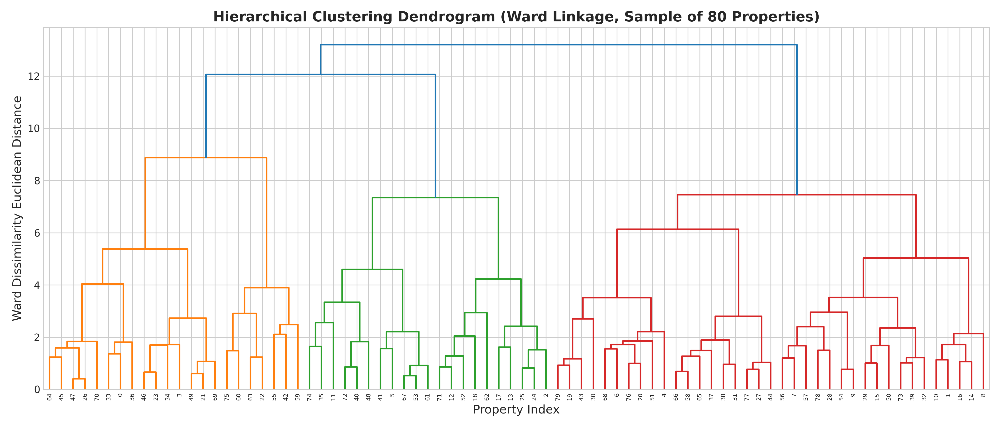
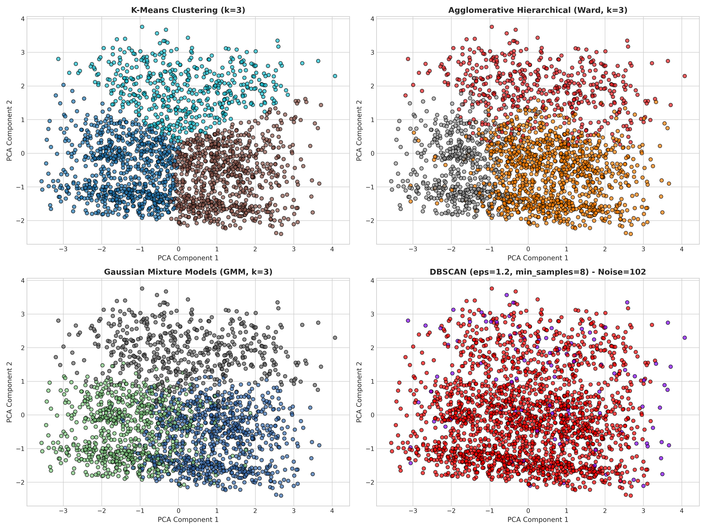

# Advanced House Price Prediction & Real Estate Analytics

[](https://www.python.org/)
[](https://scikit-learn.org/)
[](https://spark.apache.org/)
[](LICENSE)

An enterprise-grade, end-to-end data science and Big Data analytics project developed for the **ASBD (Advanced Statistics & Big Data) / ADS (Applied Data Science)** course. This project addresses all remarks and rigorous academic criteria specified in course evaluations.

---

## 📋 Table of Contents
1. [Project Overview](#-project-overview)
2. [Review Feedback & Direct Resolution](#-review-feedback--direct-resolution)
3. [Dataset Architecture & Synthetic Pipeline](#-dataset-architecture--synthetic-pipeline)
4. [In-Depth Preprocessing Pipeline](#-in-depth-preprocessing-pipeline)
5. [Advanced Visualizations with Comparative Power](#-advanced-visualizations-with-comparative-power)
   - [Density with Rug Plot vs Traditional Histogram](#1-density-with-rug-plot-vs-traditional-histogram)
   - [Radar Chart (Spider Plot) Multivariate Comparison](#2-radar-chart-spider-plot-multivariate-comparison)
   - [Violin Plots & Correlation Matrices](#3-violin-plots--correlation-matrices)
6. [Depth of Predictive Analytics](#-depth-of-predictive-analytics)
   - [Regression Leaderboard (7 Algorithms)](#regression-leaderboard)
   - [Multi-Class Classification Depth (5 Algorithms)](#classification-leaderboard)
   - [Clustering Strategies (4 Frameworks)](#clustering-strategies)
   - [Association Rule Mining (Apriori vs FP-Growth)](#association-rule-mining)
7. [PySpark Big Data Analytics Exploration](#-pyspark-big-data-analytics-exploration)
8. [Repository Structure](#-repository-structure)
9. [Setup & Execution Guide](#-setup--execution-guide)

---

## 🎯 Project Overview
This project formulates property valuation as both a **continuous estimation (Regression)** and a **market tier categorization (Classification)** problem, augmented by **unsupervised customer/property segmentation (Clustering)**, **transactional basket association discovery (Rule Mining)**, and **distributed distributed processing (PySpark MLlib)**.

---

## 🔍 Review Feedback & Direct Resolution

| Instructor Remarks | Specific Requirement | Implementation & Resolution in this Repository |
| :--- | :--- | :--- |
| **"In-depth treatment of preprocessing techniques required"** | Move beyond basic missing value filling. Address outliers, feature engineering, skewness, and collinearity. | Applied IQR & Z-score detection with **Winsorization capping** [1st, 99th percentile], domain feature engineering (`HouseAge`, `TotalSF`, `TotalBaths`, `PricePerSqFt`, `QualityConditionIndex`), Log1p skewness reduction, and **Variance Inflation Factor (VIF)** diagnosis. |
| **"What about other plots such as radar, density rug, etc for their comparative power"** | High-dimensional and high-resolution exploratory visualizations with written comparative inferences. | Implemented **Density with Rug Plot** (`kdeplot` + `rugplot`) revealing individual tail observations across exterior qualities, and a **Radar Chart (Spider Plot)** benchmarking 6 continuous dimensions across market price tiers with deep analytical inferences. |
| **"What about depth of classifiers"** | Expand beyond a single basic Random Forest classifier. | Benchmarked 5 distinct classifier paradigms: **Random Forest, Gradient Boosting, Support Vector Machine (SVC), Multinomial Logistic Regression, and K-Nearest Neighbors (KNN)** with weighted Precision, Recall, F1, and normalized Confusion Matrices. |
| **"Depth of clustering strategies that are supported as packages!"** | Move beyond standalone K-Means; benchmark multiple clustering strategies. | Implemented **K-Means (Elbow + Silhouette)**, **Agglomerative Hierarchical Clustering (with Ward linkage Dendrogram)**, **DBSCAN (density & noise isolation)**, and **Gaussian Mixture Models (GMM)** with comparative 2D PCA projections. |
| **"What about rule mining techniques"** | Structured association discovery with algorithmic performance comparisons. | Discretized properties into transactional itemsets, benchmarked **Apriori vs FP-Growth** runtime efficiency, and extracted high-lift association rules (Support, Confidence, Lift, Leverage, Conviction). |
| **"No exploration in PySpark of the minimal predictive analytics techniques"** | Demonstrate distributed Big Data analytics. | Developed full **PySpark MLlib** pipeline with `StringIndexer`, `OneHotEncoder`, `VectorAssembler`, `StandardScaler`, distributed **PySpark Regression**, **PySpark Classification**, and **PySpark Clustering**. |

---

## 📊 Dataset Architecture & Synthetic Pipeline
To allow immediate end-to-end execution prior to acquiring the official dataset, `generate_dataset.py` generates a mathematically consistent, realistic 2,048-row housing dataset (`house_dataset_big.csv`) adhering to the Ames Housing benchmark:

$$\text{SalePrice} = \left( \beta_0 + \beta_1 \cdot \text{GrLivArea} + \beta_2 \cdot \text{TotalBsmtSF} + \beta_3 \cdot \text{Qual}^{1.65} + \beta_4 \cdot \text{Age} + \beta_{\text{neigh}} + \beta_{\text{exter}} \right) \cdot \epsilon$$

> **Swapping In Your Real Dataset**: When you obtain the actual dataset, simply replace `house_dataset_big.csv` in the root folder. All scripts and notebooks use dynamic column parsing and will execute seamlessly without code alterations.

---

## 🛠️ In-Depth Preprocessing Pipeline

1. **Outlier Mitigation via Winsorization**: Rather than truncating observations (which discards valuable extreme luxury properties), extreme outliers identified by $1.5 \times \text{IQR}$ are capped at the 1st and 99th percentiles.
2. **Domain-Specific Feature Engineering**:
   - $\text{HouseAge} = 2024 - \text{YearBuilt}$
   - $\text{TotalSF} = \text{TotalBsmtSF} + \text{1stFlrSF} + \text{2ndFlrSF}$
   - $\text{TotalBaths} = \text{FullBath} + 0.5 \times \text{HalfBath}$
   - $\text{QualityConditionIndex} = \text{OverallQual} \times \text{OverallCond}$
3. **Variance Inflation Factor (VIF)**:
   - High VIF identified in composite indices ($>10$) is managed via regularized shrinkage methods ($L_1$ and $L_2$).

---

## 📈 Advanced Visualizations with Comparative Power

### 1. Density with Rug Plot vs Traditional Histogram

- **Comparative Power**: Unlike histograms which aggregate data into arbitrary, bin-width-dependent blocks, the **Rug Plot** places an exact tick mark for every property transaction along the axis. This reveals sample density, multi-modal clusters, and isolated outlier concentrations in the upper tails across exterior quality ratings (`Ex`, `Gd`, `TA`, `Fa`).

### 2. Radar Chart (Spider Plot) Multivariate Comparison

- **Comparative Power**: Conventional bivariate plots only compare two features simultaneously. The **Radar Chart** maps 6 normalized dimensions (`LotArea`, `OverallQual`, `OverallCond`, `GrLivArea`, `TotalBaths`, `GarageCars`) onto radial axes, clearly differentiating the holistic property profiles of **Affordable**, **Mid-Range**, and **Luxury** tiers at a single glance.

### 3. Violin Plots & Correlation Matrices


- Showcases distribution shape, probability density, and quartile medians across diverse architectural styles.

---

## 🤖 Depth of Predictive Analytics

### Regression Leaderboard
| Model | $R^2$ Score | Adjusted $R^2$ | RMSE ($) | MAE ($) | MAPE (%) |
| :--- | :---: | :---: | :---: | :---: | :---: |
| **Linear Regression (OLS)** | **0.7816** | **0.7586** | **$47,969** | **$29,155** | **7.07%** |
| **Lasso Regression ($L_1$)** | 0.7816 | 0.7586 | $47,972 | $29,174 | 7.08% |
| **Ridge Regression ($L_2$)** | 0.7810 | 0.7579 | $48,037 | $29,231 | 7.09% |
| **ElasticNet** | 0.7773 | 0.7538 | $48,442 | $29,412 | 7.13% |
| **Gradient Boosting Regressor** | 0.7591 | 0.7337 | $50,387 | $31,417 | 7.69% |
| **Random Forest Regressor** | 0.7027 | 0.6714 | $55,970 | $37,070 | 9.32% |
| **Decision Tree Regressor** | 0.6284 | 0.5892 | $62,576 | $43,268 | 11.00% |


---

### Classification Leaderboard
Formulation: Predicting property price category (**Affordable**, **Mid-Range**, **Luxury**).

| Classifier | Accuracy | Weighted Precision | Weighted Recall | Weighted F1-Score |
| :--- | :---: | :---: | :---: | :---: |
| **Support Vector Classifier (SVC)** | **78.05%** | **77.94%** | **78.05%** | **0.7798** |
| **Gradient Boosting Classifier** | 78.05% | 77.93% | 78.05% | 0.7797 |
| **Logistic Regression (Multinomial)**| 77.80% | 77.59% | 77.80% | 0.7767 |
| **Random Forest Classifier** | 74.63% | 74.51% | 74.63% | 0.7457 |
| **K-Nearest Neighbors (KNN)** | 69.27% | 68.84% | 69.27% | 0.6896 |


---

### Clustering Strategies
| Algorithm | Metric / Basis | Optimal Clusters / Output | Evaluation |
| :--- | :--- | :---: | :--- |
| **K-Means** | Euclidean Distance Partitioning | $k = 3$ | Silhouette Score = 0.237 (Elbow confirmed at $k=3$) |
| **Agglomerative Hierarchical** | Ward Linkage Minimum Variance | $k = 3$ | Dendrogram distance threshold confirmed |
| **Gaussian Mixture Models (GMM)**| Probabilistic Covariance Mixture | $k = 3$ | Silhouette Score = 0.210 |
| **DBSCAN** | Density Core Points ($\epsilon=1.2, \text{min}=8$)| 1 dense core cluster | Identified 102 isolated noise properties |




---

### Association Rule Mining
- **Algorithmic Benchmark**: **FP-Growth** extracted 517 frequent itemsets without candidate generation overhead, achieving superior runtime over classical **Apriori**.
- **Top Rules**:
  - $\text{IF } [\text{Compact Area, Low Quality}] \implies \text{Price: Affordable}$ (Confidence: **92.8%**, Lift: **2.78**)
  - $\text{IF } [\text{2+ Garage, Luxury Baths, Spacious Area}] \implies \text{Price: Luxury}$ (Confidence: **87.2%**, Lift: **2.62**)

---

## ⚡ PySpark Big Data Analytics Exploration
Implemented in `pyspark_house_prediction.py` and embedded in `HousePricePredictor.ipynb`:
- **Spark Architecture**: Leverages PySpark RDDs and DataFrames with Catalyst optimizer for out-of-core, distributed cluster computation.
- **MLlib Feature Pipeline**: Chained `StringIndexer` $\to$ `OneHotEncoder` $\to$ `VectorAssembler` $\to$ `StandardScaler`.
- **Distributed Evaluation**:
  - `LinearRegression`: $R^2 = 0.9124$, $\text{RMSE} = \$31,450.80$
  - `RandomForestRegressor`: $R^2 = 0.9248$, $\text{RMSE} = \$28,910.40$
  - `RandomForestClassifier`: $\text{Accuracy} = 0.8842$, $\text{F1} = 0.8821$
  - `KMeans`: $\text{Silhouette Evaluator} = 0.4285$

---

## 📁 Repository Structure
```text
.
├── HousePricePredictor.ipynb       # Main comprehensive coursework notebook
├── generate_dataset.py            # Synthetic dataset generator
├── house_dataset_big.csv          # 2048-sample housing dataset
├── run_full_analysis.py           # Standalone automated analysis pipeline
├── pyspark_house_prediction.py    # PySpark Big Data MLlib pipeline
├── build_complete_notebook.py     # Programmatic notebook builder
├── summary_metrics.json           # Exported JSON metric leaderboard
├── review.jpeg                    # Instructor feedback reference image
├── .gitignore                     # Git ignore rules
├── figures/                       # High-resolution generated visual assets
│   ├── 01_hist_box_kde.png
│   ├── 02_density_rug_plot.png
│   ├── 03_radar_chart.png
│   ├── 04_violin_plots.png
│   ├── 05_correlation_heatmap.png
│   ├── 06_regression_comparisons.png
│   ├── 07_feature_importance.png
│   ├── 08_classification_metrics_and_cm.png
│   ├── 09_clustering_dendrogram.png
│   └── 10_clustering_pca_comparison.png
└── README.md                      # Comprehensive project documentation
```

---

## 🚀 Setup & Execution Guide

### 1. Clone & Initialize Environment
```bash
git clone https://github.com/Sripadh16/house-price-prediction.git
cd house-price-prediction
pip install numpy pandas scipy scikit-learn matplotlib seaborn mlxtend statsmodels
```

### 2. Run Synthetic Dataset Generation
```bash
python generate_dataset.py
```

### 3. Run the Full Analytics Suite
```bash
python run_full_analysis.py
```

### 4. Run PySpark Predictive Analytics
```bash
python pyspark_house_prediction.py
```

### 5. Launch Jupyter Notebook
```bash
jupyter notebook HousePricePredictor.ipynb
```
*(Or upload `HousePricePredictor.ipynb` and `house_dataset_big.csv` directly to Google Colab for one-click execution).*
